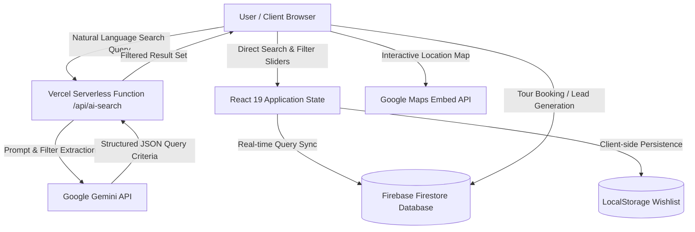

# ESTORA — Luxury AI-Powered Real Estate Platform 🏛️

> **A High-Performance Real Estate Discovery Platform featuring Natural Language Search powered by Google Gemini, 3D Hover Physics, and Serverless Cloud Architecture.**

[](https://estora-realestate.vercel.app)
[](https://github.com/dheerajeshwar32/Estora)

[]()
[]()
[]()
[]()
[]()

> 🌐 **Live Web Application**: [https://estora-realestate.vercel.app](https://estora-realestate.vercel.app)

---

## 🌟 Overview

**ESTORA** is a modern, high-performance web application designed for luxury real estate discovery, property valuation insights, and lead generation. Developed as a comprehensive full-stack Web Development project exceeding all Project Design Requirements (PDR), the platform combines high-end visual elegance with serverless cloud infrastructure and generative AI.

Users can search properties using conversational natural language (e.g., *"3-bedroom penthouse in Mumbai under 5 crores with a private pool and ocean view"*), compare complex specifications across multiple listings side-by-side, interact with dynamic Google Maps pins, calculate monthly mortgage schedules with real-time interest sliders, and schedule on-site VIP tours directly into a real-time cloud database.

---

## 🧠 System Architecture



---

## ✨ Key Features

- 🤖 **AI-Powered Conversational Search**:
  - Leverages Google's **Gemini API** via serverless edge functions to parse unstructured colloquial user queries into structured database queries.
  - Understands budget ranges, bedroom configurations, city sub-districts, and luxury amenity requests.
- ⚖️ **Side-by-Side Property Comparison Matrix**:
  - Compare up to 3 saved properties simultaneously across carpet area, price per sq.ft, maintenance costs, and architectural styles.
- 🗺️ **Adaptive Interactive Maps**:
  - Live Google Maps integration pinpointing luxury developments with dark/light mode CSS filters.
- 📱 **Apple-Style 3D Physics & Micro-Interactions**:
  - 3D perspective hover tilts, magnetic button pull effects, and spring transitions built with **Framer Motion**.
- 🧮 **Interactive Mortgage & EMI Calculator**:
  - Real-time loan calculator with dynamic principal sliders, down payment ratios, and visual amortization breakdown.
- 📅 **Multi-Step Site Tour Booking**:
  - Animated scheduling modal enabling buyers to reserve in-person or virtual VIP walk-throughs synced directly with Firebase Firestore.
- 🛡️ **Authenticated Agent Portal**:
  - Secure admin control panel for property brokers to add, edit, or archive listings, upload high-resolution media, and monitor lead conversions.
- 🌗 **Deep Midnight & Glacier Silver Theming**:
  - Fully dynamic Tailwind CSS v4 design tokens with seamless theme toggling.

---

## 🛠️ Tech Stack

| Domain | Technology | Role |
|:---|:---|:---|
| **Frontend Framework** | React 19, Vite, React Router DOM v7 | Single-page application architecture & routing |
| **Styling & Design** | Tailwind CSS v4, CSS Custom Properties | Responsive layout, dark mode, typography |
| **Animation Physics** | Framer Motion | 3D card tilt, magnetic cursors, fluid page transitions |
| **Generative AI** | Google Gemini API | Natural language search parsing & parameter extraction |
| **Backend & Database** | Firebase (Firestore, Auth, Storage) | Real-time database, agent authentication, media hosting |
| **Serverless Compute** | Vercel Serverless Functions | Secure API gateway for AI inference |
| **Icons** | Lucide React | Modern vector iconography |

---

## 🚀 Local Installation & Setup

### Prerequisites
- Node.js 18+
- npm or pnpm
- Firebase project credentials
- Google Gemini API Key

### 1. Clone the Repository
```bash
git clone https://github.com/dheerajeshwar32/Estora.git
cd Estora/estora
```

### 2. Install Dependencies
```bash
npm install
```

### 3. Configure Environment Variables
Create a `.env` file in the `estora` directory:
```env
VITE_FIREBASE_API_KEY=your_firebase_api_key
VITE_FIREBASE_AUTH_DOMAIN=your_project.firebaseapp.com
VITE_FIREBASE_PROJECT_ID=your_project_id
VITE_FIREBASE_STORAGE_BUCKET=your_project.appspot.com
VITE_FIREBASE_MESSAGING_SENDER_ID=your_sender_id
VITE_FIREBASE_APP_ID=your_app_id
VITE_GEMINI_API_KEY=your_gemini_api_key
```

### 4. Run Development Server
```bash
npm run dev
```
Open **http://localhost:5173** in your browser.

---

## 👤 Author

* **Nagula Dheeraj Eshwar Prudhvi**
* GitHub: [@dheerajeshwar32](https://github.com/dheerajeshwar32)
* Live Application: [Estora on Vercel](https://estora-realestate.vercel.app)
